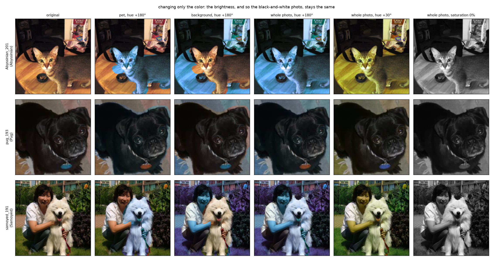
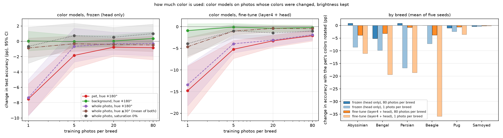
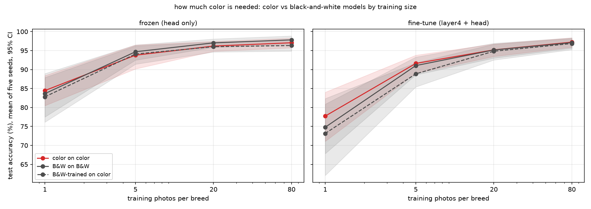
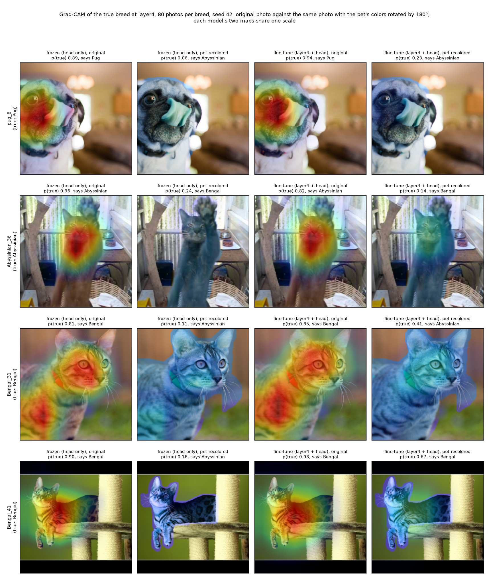
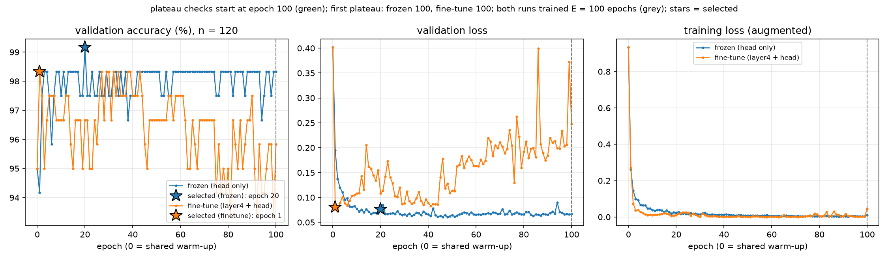
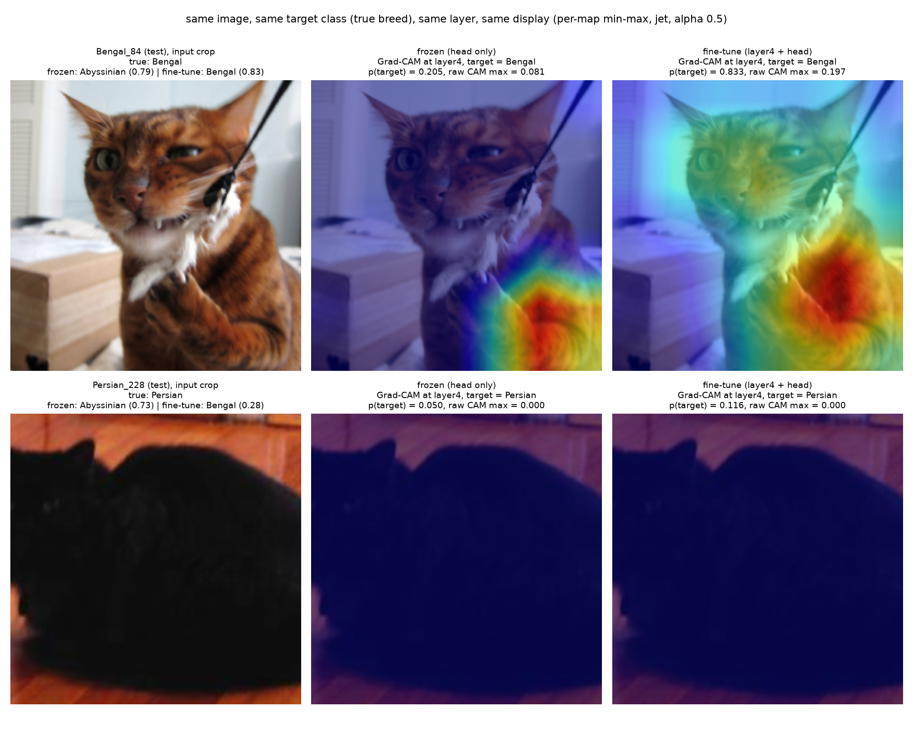

<div align="center">

# When does fine-tuning help, and what is color worth?

**DATA 37000 · Final Project · Autumn 2026 · Duorui Xu**


</div>

---

> **In two sentences.** A pretrained ResNet18 tells six cat and dog breeds apart about equally well whether or not `layer4` is fine-tuned, and whether or not it ever sees color.
> But *not needed* is not *not used*: change only a pet's colors, with its brightness held exactly fixed, and the color-trained models stumble, and the fewer photos they learned from, the harder they fall.

---

## Three findings

<table>
<tr>
<td width="33%" valign="top">

### 1 · Fine-tuning doesn't pay off

**587 vs. 584** of 598 test photos<br>(98.16% vs. 97.66%)

Exact McNemar p = 0.61; difference +0.50 points, 95% CI −0.67 to +1.67.

The same holds under the assignment's literal stopping rule and over five seeds (+0.17 points). With few photos the frozen head is *better*: **84.45% vs. 77.73%** with one photo per breed (difference −6.72 points, CI −10.60 to −2.94).

</td>
<td width="33%" valign="top">

### 2 · Color isn't needed

**Within 1 point** with 80 photos per breed, trained and tested in black and white vs. in color

With 80 photos per breed: frozen +0.77 (CI −0.37 to +1.97), fine-tuned −0.13 (CI −1.47 to +1.14), over five seeds.

Even with **one photo per breed** the gap is small and inside the noise: −0.80 (frozen) and −2.94 (fine-tuned, CI −7.12 to +0.84).

</td>
<td width="33%" valign="top">

### 3 · …but it is used

**−14.78 points** when only the pet's colors are rotated 180°

Fine-tuned color models lose accuracy at every training size, from −14.78 (1 photo per breed) to −2.07 (80); every interval lies below zero. Frozen models lose 7.53 and 1.84 points with 1 and 5 photos.

Rotating the **background's** colors changes accuracy by less than 1 point everywhere.

</td>
</tr>
</table>

---

## The test: change the color, keep the brightness

<p align="center"></p>

Each test photo is converted to YCbCr and only its two color channels are rotated around the color wheel. The ITU-R 601 brightness, the very quantity `transforms.Grayscale` keeps, stays unchanged except in the 1.2–3.8% of pixels that must be clipped, so **the black-and-white version of the photo is the same image**. Models that learned in black and white therefore cannot see the change, and they serve as a built-in control: on photos rotated by 180°, 8 of 10 give exactly the same answer on all 598 photos, and the other two change 1 and 2. The trimaps that ship with Oxford-IIIT Pet let the change hit the pet only, the background only, or the whole photo. A white Samoyed has almost no color to rotate, so it barely changes, by construction.

---

## What the models need, and what they use

<p align="center"></p>
<p align="center"><i>Color models on recolored test photos: change in accuracy by training size (left, middle) and by breed (right). Mean of five seeds, 95% intervals over seeds and photos.</i></p>

<p align="center"></p>
<p align="center"><i>Color vs. black-and-white models by training size: the curves nearly coincide, even at one photo per breed.</i></p>

<p align="center"></p>
<p align="center"><i>Grad-CAM of the true breed before and after the pet's colors are rotated, one shared scale per model. Shapes and textures are untouched, yet the evidence vanishes and the models name the look-alike.</i></p>

---

## What surprised me

- **A wrong color is worse than no color.** For a fine-tuned model trained on one photo per breed, rotating the whole photo's colors costs 13.41 points, while removing color entirely costs 3.91 (difference −9.50, CI −14.05 to −4.88).
- **A realistic color error barely matters.** A ±30° hue shift, about what a wrong white balance does, costs nothing measurable for the frozen model, and only 4.63 and 1.02 points for the fine-tuned model with 1 and 5 photos per breed.
- **The Pug doesn't care.** Its fawn coat looked like a textbook diagnostic color, yet rotating it costs at most 3.60 points; the black mask and flat face carry the breed. With a single training photo per breed, it is the **Beagle** (−35.80 points, fine-tuned) and the many-colored **Persian** that fall: a model that has seen one Persian has probably learned that one cat's color.
- **The flips land where Part 1's errors were.** About half of the photos that flip at 80 photos per breed move between the two cats, Bengal → Abyssinian (39) and Abyssinian → Bengal (33). These are the two breeds that are not ImageNet classes, and every cat error in Part 1 involves one of them.

---

## Why it matters

1. **Accuracy can hide what a model relies on.** Removing color in training says it isn't *needed*; changing it at test time shows it is *used*. Both are true at once, as Hermann and Lampinen (2020) predict for easy features: a network that has color will lean on it even when other cues would do. Held-out accuracy alone would have missed this.
2. **A practical answer for small datasets.** On six breeds the frozen head is as accurate as fine-tuning, cheaper to get right, and *better* with few photos. Fine-tuning also makes the model lean harder on color, which matters wherever lighting, white balance or filters vary.
3. **A clean, cheap counterfactual.** Brightness-preserving recoloring plus trimaps needs no retraining, has an exact built-in control, and separates the animal's color from the scene's. Here it shows that the models do not use the background's color as a shortcut.
4. **Results that can be trusted.** Each part's choices and analysis plan were locked before its test results existed, reruns reproduce the checkpoints bit for bit, and every comparison is paired, repeated over five seeds and reported with intervals. (The Part 1 lock file was rewritten once, with unchanged selections and checkpoint hashes, by a re-execution on November 18; the notebook shows the evidence and now refuses to rewrite any lock.)

---

## How it was done

| | |
|---|---|
| **Data** | Oxford-IIIT Pet, six breeds (Abyssinian, Bengal, Persian, Beagle, Pug, Samoyed). Per breed an 80/20 split of the official trainval images: 480 training, 120 validation; the official test split gives 598 photos. |
| **Models** | ResNet18 with `IMAGENET1K_V1` weights and a new `Linear(512, 6)` head. *Frozen*: head only (3,078 trainable parameters). *Fine-tuned*: `layer4` + head (8,396,806), learning rates 1e-4 / 1e-3, frozen BatchNorm statistics kept fixed as in Lab 7a. |
| **Protocol** | Shared one-epoch head-only warm-up; both models trained in lockstep on identical, hashed batches; Adam, batch 16, no weight decay; plateau rule (2 epochs) checked from epoch 100, cap 200, a deliberate deviation from the floor of 5 (the literal rule is reported as a check); checkpoint chosen on validation accuracy, then validation loss, then the earlier epoch. |
| **Part 1** | The required comparison, plus a check with the assignment's literal rule (floor of 5 epochs). |
| **Part 2a** | The same protocol on black-and-white photos, 80 photos per breed, five seeds (42, 1, 2, 3, 4). *Idea suggested by Prof. Lo in his office hours.* |
| **Part 2b** | 1, 5 and 20 photos per breed (30 new training pairs, nested subsets), plus brightness-preserving recoloring of the test photos for all 40 color models. |
| **Statistics** | Wilson intervals, exact McNemar tests, paired bootstrap with 10,000 resamples; Part 2 resamples both seeds and photos. One main comparison per question is fixed in the lock; the rest is reference or descriptive. |

<details>
<summary><b>Part 1 numbers at a glance</b></summary>

| | Frozen (head only) | Fine-tuned (`layer4` + head) |
|---|---:|---:|
| Test accuracy | 584/598 (97.66%) | 587/598 (98.16%) |
| Macro-F1 | 0.9765 | 0.9814 |
| Trainable parameters | 3,078 | 8,396,806 |
| Wall-clock per epoch (GPU compute) | 1.93 s (0.36 s) | 2.12 s (0.56 s) |
| Selected epoch · training time to it | 20 · 37.6 s | 1 · 2.0 s |
| Extra memory for gradients and Adam | — | +96 MiB |

<p align="center"></p>
<p align="center"></p>

</details>

---

## Reproduce it

**1 · Data.** Nothing to download by hand. The data cell calls `torchvision.datasets.OxfordIIITPet(..., download=True)`, which fetches the images and annotations (trimaps included) from the official site, <https://www.robots.ox.ac.uk/~vgg/data/pets/>, into `../data/bigdata/oxford-iiit-pet`, next to the project folder.

**2 · Environment.** The reported run used Windows 11, Python 3.12.0, PyTorch 2.11.0+cu128, torchvision 0.26.0+cu128, CUDA 12.8 and cuDNN 9.19 on an NVIDIA GeForce RTX 5060 Laptop GPU (8 GB). The exact versions are also recorded in `results/run_config.json`.

```bash
pip install torch==2.11.0 torchvision==0.26.0 --index-url https://download.pytorch.org/whl/cu128
pip install -r requirements.txt   # numpy, pandas, scipy, scikit-learn, matplotlib, pillow, jupyter
```

**3 · Run.** Open `d370_final_results.ipynb` from the project folder and choose *Kernel → Restart & Run All*, or run `python d370_final.py` from the project folder; the two hold the same 41 code cells in the same order, and nothing has to be edited. Set the environment variable `D370_DATA` if the dataset is not in `../data/bigdata`. The included `results/` folder is the record of the reported run, with its three lock files, and no lock is ever rewritten: Part 1 is retrained and must reproduce its locked checkpoints bit for bit, and finished Part 2 pairs are reloaded from `checkpoints/` (about 12 minutes on the GPU below). Without those weights or on other hardware the checkpoints differ and the Part 1 lock check stops the run; set `D370_TAG=rerun` to rerun everything from scratch into `results_rerun/`, `figures_rerun/` and `checkpoints_rerun/` instead (about 1.5 hours).

**4 · Seeds and split.** Seed 42 drives the split, the warm-up and both Part 1 runs, and every bootstrap is seeded from it; Part 2 repeats training with seeds 42, 1, 2, 3 and 4, and Part 2b draws each seed's nested subsets with NumPy's generator `[seed, 2026]`. The split is written to `results/split.json`, `split_manifest.csv`, `split_counts.csv` and `class_mapping.json`, and a rerun checks that it comes out identical. cuDNN autotuning and TF32 are off and PyTorch runs in deterministic mode; on the machine above, reruns reproduced every checkpoint with the same SHA-256 hash.

**5 · Where every number comes from.**

| | Lock written before the test | Results |
|---|---|---|
| Part 1 | `results/locked_choices.json` | `results/test_metrics.json`, `table_main.csv`, `table_per_class.csv`, `test_predictions.csv`, `literal_rule_check.json`, `gradcam_summary.csv`, `gradcam_supplement.csv` |
| Part 2a | `results/ext_gray/locked_extension.json` | `results/ext_gray/SUMMARY.md`, `seeds.csv`, `per_breed_recall_mean_over_seeds.csv` |
| Part 2b | `results/ext_size/locked_size_and_color.json` | `results/ext_size/SUMMARY.md`, `need_by_size.csv`, `finetune_minus_frozen_by_size.csv`, `use_by_size.csv`, `use_by_breed.csv`, `moves_pet_hue180_k80.csv` |

**6 · Not included.** The dataset (downloaded by the notebook) and the model weights in `checkpoints/` (more than 1 GB) are left out on purpose, as the assignment asks.

---

## Files

| File | What it is |
|---|---|
| `report.md` | The report: question, protocol, results, error analysis, extension, limitations |
| `d370_final_results.ipynb` | The executed notebook with commentary, the record of the reported run (code cells 1–41, in order) |
| `d370_final.py` | The same 41 code cells as a plain script |
| `requirements.txt` | Python packages |
| `results/` | Every table, lock file and summary |
| `figures/` | Every figure (fig1–fig4, figS1 and figS2 for Part 1, figE1–figE4 for Part 2a, figE11–figE14 for Part 2b) |
| `assets/badges/` | The badges at the top of this page |

The same files are on GitHub: <https://github.com/AlastorrrXu/d370-final-xu-duorui>.

---

## Credits, references and AI use

**Data, model and code.** The Oxford-IIIT Pet dataset (Parkhi et al., 2012) was created by O. M. Parkhi, A. Vedaldi, A. Zisserman and C. V. Jawahar at the Visual Geometry Group, University of Oxford, and is shared under a CC BY-SA 4.0 license; the figures that show its photos are shared under the same license. The pretrained network is ResNet18 (He et al., 2016) with torchvision's `IMAGENET1K_V1` weights. The frozen-BatchNorm handling and the best-validation checkpoint follow DATA 37000 Lab 7a, and Grad-CAM (Selvaraju et al., 2017) follows Lab 7b.

**Extension idea.** Comparing what the models learn from black-and-white photos was Prof. Lo's suggestion in his office hours. I designed the experiment around it and ran it.

**References.**

- Bramão, I., Reis, A., Petersson, K. M., & Faísca, L. (2011). The role of color information on object recognition: A review and meta-analysis. *Acta Psychologica, 138*(1), 244–253. <https://doi.org/10.1016/j.actpsy.2011.06.010>
- He, K., Zhang, X., Ren, S., & Sun, J. (2016). Deep residual learning for image recognition. In *Proceedings of the 2016 IEEE Conference on Computer Vision and Pattern Recognition* (pp. 770–778). <https://doi.org/10.1109/CVPR.2016.90>
- Hermann, K. L., & Lampinen, A. K. (2020). What shapes feature representations? Exploring datasets, architectures, and training. *Advances in Neural Information Processing Systems, 33*, 9995–10006.
- Kornblith, S., Shlens, J., & Le, Q. V. (2019). Do better ImageNet models transfer better? In *Proceedings of the 2019 IEEE/CVF Conference on Computer Vision and Pattern Recognition* (pp. 2656–2666). <https://doi.org/10.1109/CVPR.2019.00277>
- Parkhi, O. M., Vedaldi, A., Zisserman, A., & Jawahar, C. V. (2012). Cats and dogs. In *Proceedings of the 2012 IEEE Conference on Computer Vision and Pattern Recognition* (pp. 3498–3505). <https://doi.org/10.1109/CVPR.2012.6248092>
- Selvaraju, R. R., Cogswell, M., Das, A., Vedantam, R., Parikh, D., & Batra, D. (2017). Grad-CAM: Visual explanations from deep networks via gradient-based localization. In *Proceedings of the 2017 IEEE International Conference on Computer Vision* (pp. 618–626). <https://doi.org/10.1109/ICCV.2017.74>

**AI use.** I used Claude (Anthropic) to help write and test the code, search the literature and draft the text. I ran every experiment on my own GPU and checked every number against the notebook outputs.
