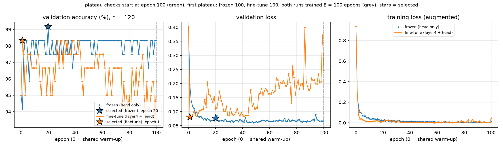
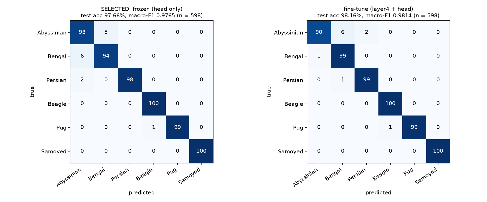
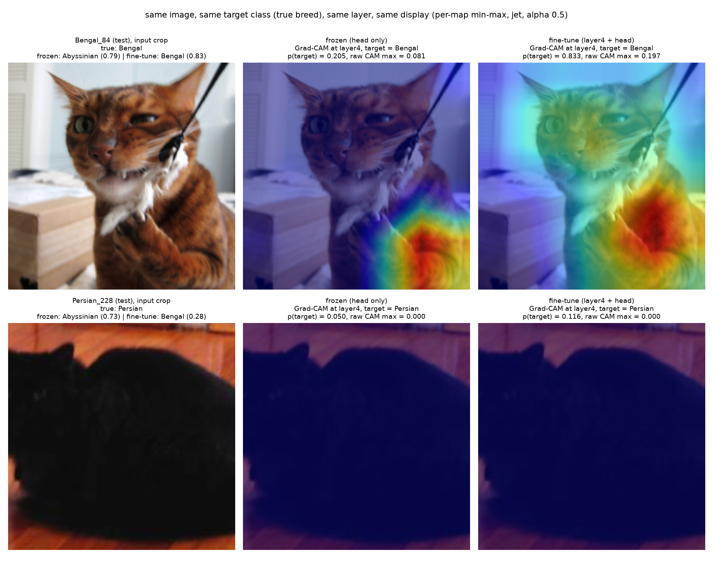

# When does fine-tuning help, and what is color worth?

**DATA 37000 Final Project · Autumn 2026 · Duorui Xu**

All results come from `d370_final_results.ipynb` (code cells 1–41, run top to bottom; the same code is in `d370_final.py`). Tables are in `results/`, figures in `figures/`, and the project is on GitHub: <https://github.com/AlastorrrXu/d370-final-xu-duorui>.

## 1. Question

Does partially fine-tuning an ImageNet-pretrained ResNet18 (`layer4` plus a new head) improve its predictions on six Oxford-IIIT Pet breeds enough to justify the cost, compared with training only the head on the frozen network? For the extension I followed Prof. Lo's office-hours suggestion to let the same models learn from black-and-white photos, and asked what color is worth to them: do they *need* it, and do they *use* it?

## 2. Data and protocol

**Data.** Oxford-IIIT Pet (Parkhi et al., 2012) has 7,349 photos of 37 breeds, split by its authors into 3,680 development and 3,669 test photos. The six default breeds (Abyssinian, Bengal, Persian, Beagle, Pug, Samoyed; original labels 0, 5, 23, 4, 25, 29, remapped to 0–5) have exactly 100 development photos each, split 80/20 within each breed with NumPy's generator seeded 42: 480 training and 120 validation photos. Their 598 test photos (98 Abyssinian, 100 of each other breed) were loaded only after every choice was locked. Split indices, image IDs, counts and the class mapping are saved in `results/`.

**Training.** Both models are ResNet18 (He et al., 2016) with torchvision's `IMAGENET1K_V1` weights and a new `Linear(512, 6)` head, adapted from Lab 7a: the *frozen* model trains the head, the *fine-tuned* model also `layer4`. Both use Adam (no weight decay, batch size 16; learning rate 1e-3 for the head, 1e-4 for `layer4`), and BatchNorm layers without trainable parameters stay in eval mode, so frozen statistics stay fixed. Training uses random crops and flips, evaluation center crops (224 pixels from images resized to 256), all ImageNet-normalized. After one shared, saved epoch of head-only warm-up (114/120 validation photos right), both models train on identical, hashed mini-batches, on an RTX 5060 Laptop GPU (CUDA 12.8, PyTorch 2.11.0) with seed 42 and deterministic algorithms; a rerun reproduces both selected checkpoints bit for bit.

**Epochs and selection.** I keep the plateau rule (2 epochs without a new best validation accuracy) but check it only from epoch 100 on, a deliberate deviation: one epoch is only 30 optimizer steps (Kornblith et al., 2019, fine-tuned for 20,000 steps), and validation accuracy moves in steps of 0.83 points, so a two-epoch plateau occurs by chance early on (under the literal rule both models stop at epoch 5). Both trained for 100 epochs and kept the checkpoint with the best validation accuracy (ties: lower validation loss, then the earlier epoch); Table 1 also shows what the literal rule selects.

**Locks and statistics.** Selections, checkpoint hashes and the analysis plan were locked before the test set was scored, separately for Parts 1, 2a and 2b. A re-execution on November 18 rewrote the Part 1 lock's date but not its selections or hashes (the first lock's hash survives in Part 2a's lock), and the code now refuses to rewrite locks. Intervals are Wilson for accuracies and paired bootstrap (10,000 resamples, over seeds and photos in Part 2) for differences, with exact McNemar tests.

## 3. Part 1: frozen vs. fine-tuned

| | Frozen (head only) | Fine-tuned (`layer4` + head) |
|---|---:|---:|
| Trainable parameters | 3,078 | 8,396,806 |
| Selected epoch (validation correct of 120) | 20 (119) | 1 (118) |
| Test accuracy (Wilson 95% CI) | 584/598 = 97.66% (96.1–98.6) | 587/598 = 98.16% (96.7–99.0) |
| Test macro-F1 | 0.9765 | 0.9814 |
| Wall-clock per epoch (GPU compute only) | 1.93 s (0.36 s) | 2.12 s (0.56 s) |
| Training time: 100 epochs / to the selected checkpoint | 193.2 s / 37.6 s | 212.4 s / 2.0 s |
| Extra memory for gradients and Adam state | | +96 MiB |
| Literal rule (stop at epoch 5): selected epoch, test correct | 4, 584/598 | 1, 587/598 |

*Table 1. Part 1 on the 598 test photos. The shared warm-up epoch took 1.9 s.*

Fine-tuning gets 3 more photos right, inside the noise: it fixes 9 and breaks 6 (exact McNemar p = 0.61), and the 95% interval for the difference is −0.67 to +1.67 points (macro-F1: −0.0080 to +0.0176); the literal rule gives the same counts. Over five seeds fine-tuning is ahead by only 0.17 points (−0.94 to +1.27), and with fewer photos it falls clearly behind: by 6.72 points with one photo per breed (−10.60 to −2.94) and by 2.17 with five (−4.08 to −0.17).

*Figure 1. Validation accuracy, validation loss and training loss (epoch 0: shared warm-up; stars: selected checkpoints).*

The frozen head stays stable for 100 epochs, while the fine-tuned model peaks after one epoch and then overfits (training loss about 0.001, validation loss rising to 0.2–0.4). Fine-tuning is cheap here (1.10× the wall-clock time per epoch and 1.56× the GPU compute, since both runs mostly wait for JPEG decoding), but it needs validation-based selection and buys no measurable gain.

## 4. Error analysis and paired Grad-CAM

*Figure 2. Test confusion matrices; the frozen model (left) is selected, with one more validation photo right (119 vs. 118).*

The dogs are nearly perfect (Beagle and Samoyed 100% recall, Pug 99%). Every cat error involves Abyssinian or Bengal, the two breeds that are not ImageNet-1K classes, and fine-tuning moves that confusion rather than removing it (Bengal errors 6 → 1, Abyssinian 5 → 8); all 16 disagreements are cats. The selected model's three most confident errors (`figures/fig3_error_cases.png`) are cats called Abyssinian with 85–95% confidence: **Bengal_9**, a backlit head showing almost none of the spotted coat (fine-tuning right, barely: 0.50 vs. 0.49); **Persian_221**, a white, odd-eyed cat with upright ears and a long muzzle, atypical or mislabeled (fine-tuning right, 0.54); and **Bengal_68**, a ruddy face with the marbled coat only on one shoulder (both wrong). In each, the face, which the two breeds share, fills the crop while the coat is hidden.

Following Lab 7b, I hook `layer4`, make the input differentiable and run both models in eval mode with gradients enabled. On Bengal_84, which only fine-tuning gets right, both models put their Bengal evidence on the spotted chest and flank rather than the face, and differ in strength (raw maximum 0.081 vs. 0.197; figS1 shows both on one scale). On Persian_228, a black cat seen from behind and wrong for both, both maps are empty because the Persian logit is negative everywhere. With the selected model's prediction, Abyssinian, as the common target (figS2), both models find the Abyssinian evidence on Bengal_84's face, and on Persian_228 only weakly and off the head: the frozen model says Abyssinian because every other breed scores even lower. That is the limit: Grad-CAM shows where positive evidence for one class lies, not why another class won, and a blank map means "no positive evidence", not "the model looked nowhere".

*Figure 3. Paired Grad-CAM at `layer4` with the true breed as target and the same layer and display (per-map min–max scaling, jet, α = 0.5) in both models.*

## 5. Extension: what is color worth?

**Design.** Only the input changes: photos are converted to black and white by `transforms.Grayscale` after the crop and flip, so each black-and-white run sees exactly its color twin's crops. Part 2a uses all 80 photos per breed and five seeds (42, 1, 2, 3, 4); Part 2b, locked afterwards, uses nested subsets of 1, 5 and 20 photos per breed, with the validation and test sets intact. On validation the black-and-white models trail their color twins by 0–1 photos (frozen) and 2–4 photos (fine-tuned); the locked test comparison pits each black-and-white model on black-and-white photos against its color twin on color photos.

| Photos per breed | Frozen: color | Frozen: B&W | Difference (95% CI) | Fine-tuned: color | Fine-tuned: B&W | Difference (95% CI) |
|---:|---:|---:|---:|---:|---:|---:|
| 1 | 84.45 | 83.65 | −0.80 (−4.41, +2.61) | 77.73 | 74.78 | −2.94 (−7.12, +0.84) |
| 5 | 93.78 | 94.68 | +0.90 (−1.07, +3.14) | 91.61 | 91.04 | −0.57 (−1.97, +0.94) |
| 20 | 96.19 | 97.02 | +0.84 (−0.33, +2.07) | 95.18 | 95.15 | −0.03 (−1.34, +1.27) |
| 80 | 97.06 | 97.83 | +0.77 (−0.37, +1.97) | 97.22 | 97.09 | −0.13 (−1.51, +1.14) |

*Table 2. Test accuracy (%), mean of five seeds, each model on its own kind of photo; the 80-photo row is Part 2a's models with Part 2b's bootstrap (Part 2a's own interval for the fine-tuned difference: −1.47 to +1.14).*

**Need.** Learning without color costs little: the frozen models stay within one point at every size, and the fine-tuned gap reaches only −2.94 points with one photo per breed, with an interval that still includes zero (though log loss is worse there: +0.06, interval +0.032 to +0.098). Models that learned in black and white lose at most 4.6 points on color photos, the closest test of Prof. Lo's idea.

**Use.** Not needing a cue is not the same as not using it: in synthetic datasets, networks favor the easiest predictive feature, and color was easier than shape or texture (Hermann & Lampinen, 2020). So I rotated only the colors of the test photos in YCbCr, which keeps their brightness, and so their black-and-white version, except in the 1.2–3.8% of pixels that must be clipped; eight of the ten black-and-white models give identical predictions on the recolored photos, a built-in control. The trimaps let me recolor the pet, the background or the whole photo (`figures/figE11_recolored_examples.png`).

Rotating the pet's colors by 180° lowers the fine-tuned models' accuracy at every size, with intervals below zero (by 14.78, 5.22, 3.28 and 2.07 points with 1, 5, 20 and 80 photos per breed; see `figures/figE13_use_of_color.png`); the frozen models lose 7.53 and 1.84 points with 1 and 5 photos and nothing measurable with more. The background's colors change accuracy by less than one point everywhere. A wrong color is worse than none: with one photo per breed, rotating the whole photo's colors costs the fine-tuned model 13.41 points, removing them only 3.91 (difference −9.50, interval −14.05 to −4.88). With 80 photos about half of the photos that flip are Bengal–Abyssinian swaps (39 and 33), while the Pug barely moves (at most 3.60 points). Of Part 2b's five locked expectations three hold, one only weakly and one in part; none of Part 2a's three is clearly supported (fine-tuning gains no more without color: −0.90 points, −2.71 to +0.74).

## 6. Conclusions, uncertainty and next experiment

**Fine-tuning** does not pay for itself here: with 80 photos per breed its gain is within the noise and it needs careful stopping, and with 1 or 5 photos per breed it is clearly worse than the frozen head. **Color** is not needed but is used, as expected of an easy feature, less so as the training set grows; held-out accuracy alone would have hidden it. Color helps people mostly when it is diagnostic (Bramão et al., 2011): the Abyssinian–Bengal swaps fit that picture, the Pug does not.

**One source of uncertainty: the seed.** One test photo is 0.17 points, and seed-to-seed standard deviations reach 1.5 points, as large as the effects; hence the five-seed averages. **Other limits.** Only two fine-tuning depths, constant learning rates, no weight decay and 120 validation photos for selection; the unnatural recolored photos measure reliance on color, not natural-photo performance; secondary intervals are not corrected for multiple comparisons. **One next experiment.** Train with random hue rotations as augmentation and test whether that removes the reliance on color without costing accuracy.

## References

Anthropic. (2026). *Claude* [Large language model]. <https://www.anthropic.com/claude>

Bramão, I., Reis, A., Petersson, K. M., & Faísca, L. (2011). The role of color information on object recognition: A review and meta-analysis. *Acta Psychologica, 138*(1), 244–253. <https://doi.org/10.1016/j.actpsy.2011.06.010>

He, K., Zhang, X., Ren, S., & Sun, J. (2016). Deep residual learning for image recognition. In *Proc. IEEE CVPR* (pp. 770–778). <https://doi.org/10.1109/CVPR.2016.90>

Hermann, K. L., & Lampinen, A. K. (2020). What shapes feature representations? Exploring datasets, architectures, and training. *Advances in Neural Information Processing Systems, 33*, 9995–10006.

Kornblith, S., Shlens, J., & Le, Q. V. (2019). Do better ImageNet models transfer better? In *Proc. IEEE/CVF CVPR* (pp. 2656–2666). <https://doi.org/10.1109/CVPR.2019.00277>

Parkhi, O. M., Vedaldi, A., Zisserman, A., & Jawahar, C. V. (2012). Cats and dogs. In *Proc. IEEE CVPR* (pp. 3498–3505). <https://doi.org/10.1109/CVPR.2012.6248092>

Selvaraju, R. R., Cogswell, M., Das, A., Vedantam, R., Parikh, D., & Batra, D. (2017). Grad-CAM: Visual explanations from deep networks via gradient-based localization. In *Proc. IEEE ICCV* (pp. 618–626). <https://doi.org/10.1109/ICCV.2017.74>

**Credits and AI use.** Data: Oxford-IIIT Pet (Parkhi et al., 2012; CC BY-SA 4.0), loaded with torchvision, trimaps included. Model: ResNet18 (He et al., 2016) with torchvision's `IMAGENET1K_V1` weights. Borrowed code: the frozen-BatchNorm handling and best-validation checkpoint follow DATA 37000 Lab 7a, and Grad-CAM (Selvaraju et al., 2017) follows Lab 7b. Extension idea: Prof. Lo's suggestion in his office hours; I designed and ran the experiment. AI use: I used Claude (Anthropic, 2026) to help write and test the code, search the literature, and draft the notebook commentary and this report. I ran every experiment on my own GPU and checked every number here against the notebook outputs.
